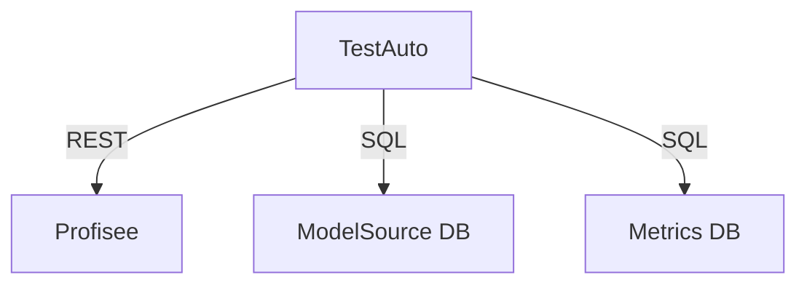

Repo: speed-merchants (paths below are repo-relative)

# Markdown Code Blocks & Documentation Formatting

Consistent formatting rules for code blocks and documentation files, optimized for readability in Obsidian, GitHub, and Cursor IDE.

## When to Use

- Writing or reviewing `.md` / `.mdc` documentation
- Creating a new skill's `SKILL.md`
- Writing a Cursor `.mdc` rule file or similar structured markdown config
- Reviewing documentation formatting in a PR
- "How should I format this code block?"
- "What callout type should I use?"

---

## Code Block Rules

### Rule 1 — Always Specify Language

Always include a language identifier after the opening triple backticks.

**Good:**
````markdown
```powershell
.\sync-ai-rules.ps1 -Force
```
````

**Bad:**
````markdown
```
.\sync-ai-rules.ps1 -Force
```
````

---

### Rule 2 — Language Identifier Reference

| Language | Identifier |
|----------|------------|
| PowerShell | `powershell` |
| C# | `csharp` |
| JavaScript | `javascript` or `js` |
| TypeScript | `typescript` or `ts` |
| JSON | `json` |
| SQL | `sql` |
| Bash/Shell | `bash` or `shell` |
| YAML | `yaml` |
| Markdown | `markdown` |
| XML | `xml` |
| HTML | `html` |
| CSS | `css` |
| Plain text / command output | `text` |

---

### Rule 3 — One Command Per Block

When documenting CLI commands, use one command per code block so users can copy individual commands.

**Good:**
````markdown
#### Push to current directory
```powershell
.\sync-ai-rules.ps1
```

#### Push with force
```powershell
.\sync-ai-rules.ps1 -Force
```
````

**Avoid:**
````markdown
```powershell
# Push to current directory
.\sync-ai-rules.ps1
# Push with force
.\sync-ai-rules.ps1 -Force
```
````

---

### Rule 4 — Header Before Code Block

Always precede a code block with a descriptive header (h4 recommended for command references).

**Good:**
````markdown
#### Install dependencies
```powershell
dotnet restore
```
````

**Avoid:** Code block with no context above it.

---

### Rule 5 — No Backticks in Tables

In tables, use plain text for code references — backticks reduce readability.

**Preferred:**

| Parameter | Default |
|-----------|---------|
| -Force | $false |
| -WhatIf | $false |

**Avoid:**

| Parameter | Default |
|-----------|---------|
| `-Force` | `$false` |

---

### Rule 6 — Inline Code for References

Use single backticks for inline code references within paragraphs.

> The `repos/` subfolder inside `.cursor/` is automatically excluded.

---

### Rule 7 — Multi-line Code Blocks

Preserve proper indentation in multi-line blocks.

```csharp
public class Example
{
    public string Name { get; set; }

    public void Process()
    {
        Console.WriteLine(Name);
    }
}
```

---

### Rule 8 — JSON Configuration Blocks

Include the full structure with proper formatting.

```json
{
  "TemplatePath": "<path>",
  "Include": ["base", "dotnet"],
  "Exclude": ["solutions"],
  "SkipVSCode": false
}
```

---

### Rule 9 — Command Output Blocks

Use `text` for command output — no language highlighting needed.

```text
[COPIED] .cursor\rules\base\coding\clean-code-guidelines.mdc
[IDENTICAL] .cursor\rules\base\agents\builder.mdc
[SKIP] .vscode\settings.json (changed, use -Force to overwrite)
```

---

### Rule 10 — Callouts for Important Code

Use Obsidian callouts to highlight important examples or warnings.

```markdown
> [!note] Standard Note
> Use for general code explanations.

> [!tip] Tip Callout
> Use for best practices and recommendations.

> [!warning] Warning Callout
> Use for code that could cause issues if misused.

> [!danger] Danger Callout
> Use for destructive or irreversible commands.

> [!example]- Collapsible Example
> Use `-` after the callout type to make it collapsible.
```

**Callout type reference:**

| Callout | Use For |
|---------|---------|
| `[!note]` | General explanations |
| `[!tip]` | Best practices, recommendations |
| `[!warning]` | Potential misuse, caution |
| `[!danger]` | Destructive or irreversible actions |
| `[!example]` | Code examples (add `-` to collapse) |

---

### Rule 11 — Diagrams: Prefer Mermaid; Keep ASCII Box Art Aligned

This project's in-app help (`TestAuto.Web/Documentation/*.md`) is rendered by MD2RazorGenerator, which **renders Mermaid** fenced blocks as real diagrams. Hand-drawn Unicode box art (`│ ┌ ┐ └ ┘ ├ ┤ ┬ ┴ ┼ ─`) does NOT auto-layout — it drifts a character or two out of alignment, leaving floating walls and boxes of unequal width that look broken in the browser.

**Prefer Mermaid for any new diagram:**



**If monospace box art is unavoidable, these rules are absolute:**

- Every line belonging to the same box must be the **exact same display width**. Count characters, not bytes — each box-drawing glyph is one column.
- Side walls (`│`) must sit in the **same column** as the `┌ ┐ └ ┘` corners above and below them.
- Inner cells in a row must be **equal width**; connectors (`│ ▼ ┬ ┴`) must align to cell centers. A label wider than its cell (e.g. `Partition` in a 10-wide cell) pushes the whole row out — size the cell to the widest label.
- Pad with spaces **before** the right wall (never let content push the wall past the border); extend `─` runs to widen borders.

**Verify before you commit** — in a framed box, the top border, every content row, and the bottom border must all report the same length:

```powershell
$L = Get-Content -LiteralPath .\TestAuto.Web\Documentation\03_DataArchitecture.md -Encoding UTF8
$a = 34; $b = 36   # the diagram's 1-based line range
for ($i = $a - 1; $i -lt $b; $i++) { "{0,4} [{1,3}] {2}" -f ($i + 1), $L[$i].Length, $L[$i] }
```

If the `[len]` column isn't identical across the box's rows, it's misaligned — fix it before saving.

---

## Quick Reference Templates

### Standard Code Block

````markdown
#### Description of what this command does
```language
command or code here
```
````

### Collapsible Callout with Code

````markdown
> [!example]- Click to expand
> ```powershell
> your-command-here
> ```
````

### Table Without Backticks

```markdown
| Parameter | Type | Default | Description |
|-----------|------|---------|-------------|
| -Force | Switch | $false | Overwrite files |
```

---

## Enforcement Checklist

- [ ] Every code block has a language identifier
- [ ] CLI commands are one-per-block
- [ ] Code blocks are preceded by a descriptive header
- [ ] Tables use plain text, not backticks
- [ ] Callouts use the appropriate type
- [ ] Multi-line code preserves indentation

---

## Sources

- `.cursor\rules\base\markdown\code-block-style-guide.mdc` (deleted 2026-05-16)
- `.cursor\rules\base\markdown\obsidian-markdown-guide.mdc` (deleted 2026-05-16)
