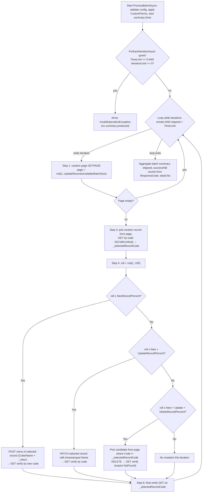

Repo: speed-merchants (paths below are repo-relative)

# TestAuto Scenario Catalog — Records, Connect, Metadata

> **Scope**: speed-merchants (TestAuto.Records, TestAuto.Connect, TestAuto.Metadata)
> **Source**: `ScenarioGuide_Records.md`, `ScenarioGuide_Connect.md`, `ScenarioGuide_Metadata.md`
> **See also**: `testauto-matching-scenarios` for `UnifiedMatchingScenario`

---

## Record Scenarios (`ScenarioBaseCrud`)

Record scenarios test CRUD performance against Profisee entities at scale. All inherit from `ScenarioBaseCrud`.

### Available Scenarios

| Scenario | Purpose | HTTP Operation |
|---|---|---|
| `CreateRecordsByPageAndBatchScenario` | Paged bulk record creation | POST /records |
| `CreatePDataScenario` | PData record creation | POST /records |
| `GetRecordByCodeScenario` | Single record retrieval by code | GET /records/{code} |
| `GetRecordsByCodeScenario` | Multi-record retrieval from a comma-delimited code list | GET /records (`RecordCodes` query parm) |
| `GetRecordsByPageAndBatchScenario` | Paged record retrieval | GET /records |
| `GetRecordsByFilterScenario` | Filtered record retrieval | GET /records?filter=... |
| `GetRecordsByPageAndBatchSeqScenario` | Sequential paged retrieval | GET /records |
| `GetRecordsByScenarioConfigurationScenario` | Config-driven retrieval | GET /records |
| `GetRecordsWithHistoryScenario` | Record retrieval with history | GET /records (history flag) |
| `UpdateRecordsByPageAndBatchScenario` | Paged bulk record updates | PATCH /records |
| `UpdateContinuousRecordsByPageAndBatchScenario` | Continuous update operations | PATCH /records |
| `DeleteRecordsByPageAndBatchScenario` | Paged bulk record deletion | DELETE /records |
| `CloneAndMutateScenario` | Clone existing records and mutate | POST /records |
| `StewardshipFilterScenario` | Stewardship filter operations | GET /records |

### Record Scenario CustomParms

```json
{
  "TimeLimit": "00:30:00",
  "IterationLimit": 0,
  "BatchSize": 100,
  "PageSize": 1000,
  "IncludeAllAttributes": false,
  "FilterExpression": "",
  "SortExpression": "Code"
}
```

Create/Update specific:

```json
{
  "ValidateBeforeWrite": true,
  "IgnoreConstraintRules": false
}
```

### Sample Configs

**CreateRecordsByPageAndBatchScenario**

```json
{
  "Name": "CreateRecords_Bulk",
  "ScenarioConfiguration": {
    "ScenarioName": "CreateRecordsByPageAndBatchScenario",
    "ScenarioTables": {
      "SourceEntityName": "TestData",
      "TargetEntityName": "Product"
    },
    "ScenarioRuntime": {
      "BatchSize": 100,
      "CustomParms": {
        "TimeLimit": "00:30:00",
        "IterationLimit": 10000
      }
    },
    "ScenarioEnvironment": {
      "TargetEnvironment": "SaaS",
      "TargetMetricEntity": "RecordApiExecution"
    }
  }
}
```

**GetRecordsByPageAndBatchScenario**

```json
{
  "Name": "GetRecords_Paginated",
  "ScenarioConfiguration": {
    "ScenarioName": "GetRecordsByPageAndBatchScenario",
    "ScenarioTables": {
      "TargetEntityName": "Product"
    },
    "ScenarioRuntime": {
      "BatchSize": 1000,
      "CustomParms": {
        "PageSize": 1000,
        "TotalPages": 100,
        "IncludeAllAttributes": true
      }
    }
  }
}
```

### `ScenarioBaseCrud` Key Methods

| Method | Purpose |
|---|---|
| `ProcessBatchAsync()` | Main processing loop |
| `ProcessBatchRecordAsync()` | Per-record operation |

### `ScenarioBase.ForEachIterationAsync` — the loop primitive behind `TimeLimit`/`IterationLimit`

The `TimeLimit` / `IterationLimit` config values above are *interpreted* by one shared protected helper on `ScenarioBase` (`TestAuto.Scenarios\Common\ScenarioBase.cs`). When you hand-write a scenario's processing loop, call this instead of rolling your own `while` — it gives you the dual time/iteration bounds, the infinite-loop guard, and standardized per-iteration progress logging for free. It is referenced as "loop infrastructure — do not modify" by the matching skills; this is what it actually does.

```csharp
protected async Task ForEachIterationAsync(
    TimeSpan timeLimit,
    int iterationLimit,
    Func<ScenarioLoopState, Task> action)
```

Semantics (verified):

- **Dual-bound loop.** Continues while `(iterationLimit == 0 || i < iterationLimit)` **and** `(timeLimit == Zero || elapsed < timeLimit)`. A **zero** value means "unlimited" for *that* dimension; pass a positive value for the dimension you want to bound. With both set, whichever limit is hit first stops the loop.
- **Infinite-loop guard.** If `timeLimit == TimeSpan.Zero && iterationLimit == 0`, it throws `InvalidOperationException` immediately — this is the enforcement behind the "both limits = 0 → infinite loop" gotcha; the scenario fails fast rather than spinning forever.
- **Early exit.** The `action` receives a mutable `ScenarioLoopState`; set `loopState.ShouldBreak = true` inside your callback (e.g. `HasMoreRecordsAsync` returned false, partition exhausted) to break after the current iteration.
- **Progress logging is automatic & mode-aware.** Each iteration logs an `═══ Iteration … ═══` banner tagged `LogTagConstants.ForScenario(ScenarioName)`. The format adapts to the active mode: iteration-driven shows `Iteration {i}/{limit}`, time-driven adds `Time Remaining`, both shows iteration count + remaining time, unbounded-by-iteration shows a bare counter. Do not re-log per-iteration progress yourself — it duplicates these banners.
- **Timing.** `i` starts at 1 on the first iteration; `elapsed` is measured from a `DateTime.UtcNow` captured before the loop. The time check is evaluated at the *top* of each iteration, so a long-running `action` can overrun `timeLimit` by up to one iteration.

`ScenarioLoopState` is intentionally tiny — just `bool ShouldBreak` — so the loop body owns its own counters/state; the helper only owns the bound checks and logging.

---

## Connect Scenarios (`ScenarioBaseConnect`)

Connect scenarios monitor and harvest metrics from Profisee Connect (ConnEx) strategy batch runs. Neither scenario starts the strategy itself — the batch is started out-of-band (manual, scheduled, or a separate workflow step). Both are `DataPattern.SelfManaged`: one Hangfire job total, no test records, scenario owns its own loop.

### Available Scenarios

| Scenario | Purpose | DataPattern | Metrics | CustomParms Editor |
|---|---|---|---|---|
| `ConnectStrategyPollingScenario` | Poll the Connect REST API until the most-recent batch for a strategy reaches a terminal state | `SelfManaged` | None (`MetricDetailNone` / `MetricBatchSummaryNone` — pass/fail summary only) | `ConnectStrategyPolling` |
| `ConnectPostRunCollectionScenario` | After a batch finishes, read per-page execution data from the `connex` DB and emit one `MetricDetailConnectApiExecution` row per `connex.tJob` page | `SelfManaged` | `MetricDetailConnectApiExecution` / `MetricBatchSummaryBase` | `ConnectPostRunCollection` |

Typical workflow sequence: strategy runs out-of-band → `ConnectStrategyPollingScenario` (gate on completion) → `ConnectPostRunCollectionScenario` (collect metrics).

### Connect CustomParms

**`ConnectStrategyPollingScenario`** — present-but-invalid values throw `ArgumentException` at config parse:

| Parm | Required | Default | Constraints |
|---|---|---|---|
| `StrategyName` | Yes | — | Connect strategy whose latest batch is polled |
| `PollIntervalSeconds` | No | `30` | 1–3600; must fit inside the wait window |
| `MaxWaitMinutes` | No | `720` (12 h) | > 0 and ≤ 1440 |

**`ConnectPostRunCollectionScenario`**:

| Parm | Required | Default | Constraints |
|---|---|---|---|
| `StrategyName` | Yes | — | Latest batch resolved via REST |
| `RunProfileCode` | Yes | — | Must be an existing `ConnectRunProfile` code (RunProfile is a domain value on `ConnectApiExecution`) |
| `MaxBatchAgeMinutes` | No | `60` | ≥ 1; older batches emit zero rows |
| `JobPageSize` | No | `1000` | 1–10000 |
| `ConcurrentThreads` | No | `4` | 1–32 |
| `OperationName` | No | `""` | When set, overrides the job `Type` in the OperationName column |
| `IncludeFailedJobsOnly` | No | `false` | Skip jobs whose `ProcessingState` is `Succeeded` |

### Sample Config — `ConnectStrategyPollingScenario`

```json
{
  "Name": "Connect_StrategyPolling",
  "ScenarioConfiguration": {
    "ScenarioName": "ConnectStrategyPollingScenario",
    "ScenarioTables": {
      "SourceEntityName": "NotUsed",
      "TargetEntityName": "NotUsed"
    },
    "ScenarioRuntime": {
      "BatchSize": 1,
      "MaxHangfireScenarioServersCount": 1,
      "MaxConcurrentBatchesPerHangfireScenarioServer": 1,
      "CustomParms": {
        "StrategyName": "DailyCustomerSync",
        "PollIntervalSeconds": "30",
        "MaxWaitMinutes": "720"
      }
    },
    "ScenarioEnvironment": {
      "TargetEnvironment": "On-prem"
    }
  }
}
```

### Sample Config — `ConnectPostRunCollectionScenario`

```json
{
  "Name": "Connect_PostRunCollection",
  "ScenarioConfiguration": {
    "ScenarioName": "ConnectPostRunCollectionScenario",
    "ScenarioTables": {
      "SourceEntityName": "Not Used",
      "TargetEntityName": "Not Used"
    },
    "ScenarioRuntime": {
      "BatchSize": 1,
      "MaxHangfireScenarioServersCount": 1,
      "MaxConcurrentBatchesPerHangfireScenarioServer": 1,
      "CustomParms": {
        "StrategyName": "RetailClient15M",
        "RunProfileCode": "26R2-SQLSERVER-PROFISEE-I-1000000-1000000-10-12",
        "MaxBatchAgeMinutes": "60",
        "JobPageSize": "1000",
        "ConcurrentThreads": "4",
        "OperationName": "",
        "IncludeFailedJobsOnly": "false"
      }
    },
    "ScenarioEnvironment": {
      "TargetEnvironment": "On-prem",
      "TargetMetricEntity": "ConnectApiExecution"
    }
  }
}
```

---

## Metadata Scenarios (`ScenarioBaseMetadata`)

Metadata scenarios test Profisee model metadata operations (entities, attributes, hierarchies, domain values).

### Available Scenarios

| Scenario | Purpose | Operation |
|---|---|---|
| `MetadataLoadScenario` | Metadata retrieval performance | GET metadata endpoints |
| `MetadataManagementScenario` | Metadata management operations | Metadata CRUD |

### Metadata CustomParms

```json
{
  "TimeLimit": "00:15:00",
  "IterationLimit": 0,
  "IncludeSystemEntities": false,
  "IncludeSystemAttributes": false
}
```

**`MetadataManagementScenario` — entity/attribute management:**

```json
{
  "entities": [
    { "name": "Customer", "action": "Add" },
    { "name": "StatusType", "action": "Add", "isDomain": true }
  ],
  "attributes": [
    { "entity": "Customer", "name": "FirstName", "action": "Add", "type": "String", "length": 50 },
    { "entity": "Customer", "name": "Status", "action": "Add", "type": "Domain", "domainEntity": "StatusType" }
  ]
}
```

Actions: `add`, `delete`, `replace` (`MetadataConstants.cs:167-169`; compared case-insensitively, so `"Add"`/`"ADD"` also work). Attribute types: `String`, `Number`, `Date`, `DateTime`, `Link`, `Domain`.

---

### Sample Config — `MetadataLoadScenario`

```json
{
  "Name": "Metadata_Load",
  "ScenarioConfiguration": {
    "ScenarioName": "MetadataLoadScenario",
    "ScenarioRuntime": {
      "CustomParms": {
        "TimeLimit": "00:15:00",
        "IncludeSystemEntities": false
      }
    },
    "ScenarioEnvironment": {
      "TargetEnvironment": "SaaS",
      "TargetMetricEntity": "MetadataApiExecution"
    }
  }
}
```

---

## Common `TargetMetricEntity` Values

| Scenario Family | TargetMetricEntity |
|---|---|
| Records | `"RecordApiExecution"` |
| Connect | `"ConnectApiExecution"` (post-run collection only; the polling scenario emits no metrics) |
| Metadata | `"MetadataApiExecution"` |
| Matching | `"MatchingApiExecution"` |

---

## Sources

- `TestAuto.Web\Documentation\ScenarioGuide_Records.md`
- `TestAuto.Web\Documentation\ScenarioGuide_Connect.md`
- `TestAuto.Web\Documentation\ScenarioGuide_Metadata.md`
- `TestAuto.Web\Documentation\ScenarioGuide_Matching.md`
- `TestAuto.Web\Documentation\ScenarioGuide_Index.md`
- `TestAuto.Metadata\Documentation\README.md`
- `TestAuto.Connect\Scenarios\ConnectStrategyPollingScenario.cs`
- `TestAuto.Connect\Scenarios\ConnectPostRunCollectionScenario.cs`
- `TestAuto.Connect\Configuration\ConnectCustomParms.cs`
- `TestAuto.Connect\Samples\TestCases\ConnectStrategyPolling.json`
- `TestAuto.Connect\Samples\TestCases\ConnectPostRunCollection.json`

---

## Scenario Usage Guidance

### Matching

**When to use `UnifiedMatchingScenario`**: This is the only matching scenario you should configure directly for new tests. The four other matching scenarios (`MatchingResultsScenario`, `MatchingSnapshotCaptureScenario`, `MatchingStrategyPollingScenario`, `UnifiedMatchingPostRunCollectionScenario`) are support/utility scenarios — they do not run the matching load themselves.

#### OperationType Decision Table

| You want to... | Use `OperationType` | Notes |
|---|---|---|
| Measure initial load into an empty model | `BatchLoad` + `ExpectEmptyModel: true` | Scenario 1 |
| Measure operational batch throughput (CM on) | `BatchLoad` + `ContinuousMatching: true` | Scenario 2 |
| Stress-test lookup speed with guaranteed matches | `LookupOnly` + `RecordSource: ExistingMatchedOnly` | Scenario 3A — no scoring triggered |
| Stress-test lookup scoring (fuzzy attribute scoring) | `LookupOnly` + `RecordSource: NewValuesOnly` | Scenario 3B — every lookup scores |
| Simulate a real user doing Lookup-then-Create | `LookupThenCreate` + `RecordSource: Mixed` | Scenario 3C — LUBC simulation |
| Direct upsert without pre-lookup | `CreateOnly` | Legacy / simple create load |

#### RecordSource Mode Decision Table

| Mode | Records returned | When to choose |
|---|---|---|
| `ExistingMatchedOnly` | All exist in Profisee already | Want lookup to always find a match (no scoring) — 3A stress test |
| `NewValuesOnly` | None exist in Profisee | Want every lookup to require scoring — 3B scoring test |
| `Mixed` | `ChangedPercent` % modified existing + remainder new | Realistic operational mix — Scenario 2 and 3C |

#### Key Gotchas — Matching

- **Do not use `NoChangePercent` in 26R1 configs.** NoChange records do not trigger matching; they inflate your record count with no test value. The percentages that count are `ChangedPercent` and `NewPercent`, and they must sum to 100.
- **`PreviouslyLoadedRecords: 0` breaks ExistingMatchedOnly mode.** Scenario 3A pulls from existing Profisee records. If this is 0 or unset, the manager finds no records and the test exits immediately.
- **Golden record timeout** (`MaxGoldenRecordAttempts` exhausted): caused by the matching/survivorship pipeline being slower than the poll interval. Increase `MaxGoldenRecordAttempts` or `WaitTimeBetweenGoldenRecordAttemptsMs` before assuming a bug.
- **Scenario 3B returning matches unexpectedly**: the `RecordSource` param is likely still `Mixed` or `ExistingMatchedOnly`. Must be `NewValuesOnly` for the scoring test to be valid.
- **Scenario 3A lookups slower than expected**: the model index was not built before the test. Run an initial batch load (Scenario 1) first or confirm the index is active.
- **Legacy `RecordMixEnabled` + `NoChangePercent`/`UpdatePercent`**: these are the pre-26R1 mix params. Use `ChangedPercent` + `RecordSource: Mixed` for all new tests. Do not mix old and new params.
- **`MaxHangfireScenarioServersCount` for timed scenarios**: Scenarios 3A/3B/3C use 20 threads — set `MaxHangfireScenarioServersCount: 20` and `MaxConcurrentBatchesPerHangfireScenarioServer: 1`. Leaving these at default 1/1 will serially process what should be concurrent load.

---

### Records

**When to use which scenario:**

| Situation | Scenario |
|---|---|
| Load-test bulk inserts at volume | `CreateRecordsByPageAndBatchScenario` |
| Load-test reads, iterating every page of a large entity | `GetRecordsByPageAndBatchScenario` |
| Read a filtered subset using an OData expression | `GetRecordsByFilterScenario` |
| Need strictly sequential (non-parallel) page reads | `GetRecordsByPageAndBatchSeqScenario` |
| Retrieve a single record repeatedly by code | `GetRecordByCodeScenario` |
| Retrieve many records in one call from a comma-delimited code list | `GetRecordsByCodeScenario` (class lives in `GetRecordsByCodes.cs` — file name ≠ class name) |
| Need record history included in the payload | `GetRecordsWithHistoryScenario` |
| Load-test PATCH updates across a large entity | `UpdateRecordsByPageAndBatchScenario` |
| Run continuous (unbounded, time-limited) updates | `UpdateContinuousRecordsByPageAndBatchScenario` |
| Clean up test data by deleting records in bulk | `DeleteRecordsByPageAndBatchScenario` |
| Derive new test records from existing ones with mutations | `CloneAndMutateScenario` |
| Test stewardship filter view performance | `StewardshipFilterScenario` |
| PData-specific record creation | `CreatePDataScenario` |

**When to use `GetRecordsByScenarioConfigurationScenario`**: When the retrieval shape (entity, attributes, filter, sort) is fully driven by the scenario JSON and you do not want to hard-code any of that in the scenario class. Use when the same infrastructure needs to run against different entities without code changes.

#### Key Gotchas — Records

- **`IterationLimit: 0` means unlimited *for that dimension only*** — pair it with a positive `TimeLimit`. Setting **both** to zero does not run forever: `ForEachIterationAsync` throws `InvalidOperationException` up front (`ScenarioBase.cs:158-163`).
- **`IncludeAllAttributes: true` on large entities** can significantly increase response payload size and skew response-time measurements. Only set this if you are explicitly testing attribute payload cost.
- **`ValidateBeforeWrite: false` / `IgnoreConstraintRules: true`** bypass server-side validation. Use only when testing raw throughput; do not use for correctness tests.
- **`GetRecordsByPageAndBatchSeqScenario` vs `GetRecordsByPageAndBatchScenario`**: Sequential variant avoids any parallel page fan-out. Use it when you need a controlled single-thread baseline, not for maximum throughput measurement.

---

### Metadata

**When to use each scenario:**

| Situation | Scenario |
|---|---|
| Measure performance of metadata read endpoints (entity list, attribute list, hierarchy) | `MetadataLoadScenario` |
| Programmatically create or delete entities and attributes as part of a test setup | `MetadataManagementScenario` |

**`IncludeSystemEntities` / `IncludeSystemAttributes`**: Leave these `false` unless you are explicitly testing system-metadata read performance. System entities/attributes add noise to response times and aren't typically relevant to customer model performance.

#### Key Gotchas — Metadata

- **`MetadataManagementScenario` is destructive** — it creates or deletes model entities/attributes. Confirm the target environment is a test environment before running. There is no undo beyond manual cleanup.
- **Action values are case-insensitive**: `MetadataCrudHelper` lowercases the value (`ToLowerInvariant`) before comparing against the lowercase constants, so `"Add"`, `"add"`, and `"ADD"` all work. An unrecognized action value fails the item with "Unknown attribute action".
- **Attribute type `Domain`** requires `domainEntity` to reference an entity that already exists (or is being created in the same scenario config, listed before the attribute). Order matters in the `entities` array.

---

### Connect

**When to use each scenario:**

| Situation | Scenario |
|---|---|
| Gate a workflow until an out-of-band Connect strategy batch finishes | `ConnectStrategyPollingScenario` |
| Harvest per-page timing/count metrics from a finished Connect batch | `ConnectPostRunCollectionScenario` |

**`ConnectStrategyPollingScenario`** is a wait/gate scenario (Connect counterpart of `MatchingStrategyPollingScenario`). It resolves the most-recent batch for `StrategyName`, then issues only a lightweight status GET per poll — no record-count pagination. Terminal-state policy: only `Succeeded` is success; `Failed`/`Deleted` are failure; any other state keeps polling until the wall-clock deadline. It emits no metric rows — just a pass/fail summary so the workflow can advance.

**`ConnectPostRunCollectionScenario`** is the metrics collector. It resolves the latest batch via REST, then reads per-page timings/counts from the `connex` DB via SQL (`connex.tBatch`/`tJob` — REST does not surface them) and emits one `ConnectApiExecution` row per `connex.tJob` page. Run it as the step after the polling scenario.

#### Key Gotchas — Connect

- **`StrategyName` must resolve to an existing batch.** If no batch is found, the polling scenario returns a failed summary immediately and the post-run scenario throws.
- **Auth is `x-api-key`, not OAuth** — injected per request by `ApiKeyHandler`, so long polling waits have no token-expiry concern.
- **Polling timeout = step failure.** `MaxWaitMinutes` (default 720, max 1440) caps the wall-clock wait. `PollIntervalSeconds` must fit inside that window or config parsing throws.
- **Post-run `TargetMetricEntity` must be `ConnectApiExecution` or blank** — any other value throws at config parse; blank defaults to `ConnectApiExecution`.
- **`RunProfileCode` must be an existing `ConnectRunProfile` code.** It is validated at runtime via DB lookup and supplies the attribute/DBA/rule snapshot counts (`AttributeCount`, `DbaCount`, `DqRuleCount`) on each metric row.
- **Post-run needs a Profisee SQL connection string** (`ScenarioDatabaseConnectionStrings.Profisee` or app config) to read `connex.tBatch`/`tJob`; if none resolves, it throws.
- **Stale-batch guard**: if the latest batch's last change is older than `MaxBatchAgeMinutes` (default 60), the post-run scenario emits zero rows (empty summary), not an error.

---

## StewardshipFilterScenario CRUD Flow

`StewardshipFilterScenario` performs randomized CRUD operations (Create / Update / Delete) against a Profisee entity to simulate realistic stewardship workloads. Every iteration runs the same read prelude (random page `GETPAGE` → single-record `GET` by code), then selects **one** mutating operation by weighted random roll, then closes with a verify `GET`.

### Operation Selection Logic

The three percentages are the live CustomParm keys `NewRecordPercent` / `UpdateRecordPercent` / `DeleteRecordPercent`, each zeroed out when its enable flag is false (`StewardshipFilterScenario.cs:332-334`).

| Roll Range | Operation | Condition |
|---|---|---|
| `roll ≤ NewRecordPercent` | CREATE | `CreateNewRecords = true` |
| `NewRecordPercent < roll ≤ NewRecordPercent + UpdateRecordPercent` | UPDATE | `UpdateExistingRecords = true` |
| `… < roll ≤ NewRecordPercent + UpdateRecordPercent + DeleteRecordPercent` | DELETE | `DeleteRecords = true` |
| roll > sum | No-op (read-only iteration) | Loop continues |

Roll is `rnd.Next(1, 101)` — 1–100 inclusive (`StewardshipFilterScenario.cs:339`). Percentages should sum to ≤ 100.

**Both limits = 0 throws — it does not loop forever.** The scenario delegates its loop to `ScenarioBase.ForEachIterationAsync` (`StewardshipFilterScenario.cs:267`), whose first statement throws `InvalidOperationException("Both IterationLimit and TimeLimit are zero. At least one must be set to a positive value to prevent an infinite loop.")` when `timeLimit == TimeSpan.Zero && iterationLimit == 0` (`ScenarioBase.cs:158-163`). The scenario fails fast at the start of `ProcessBatchAsync`.

### Flowchart



### Per-Iteration Steps

Every iteration runs the read prelude and the closing verify regardless of which branch the roll picks. Randomized sleeps (`SleepMinMs`–`SleepMaxMs`) sit between the phases.

**Shared prelude (always)**
1. Random page GET via `GetRandomPageWithMetricAsync` — page = `rnd(1 .. max(1, UpdateRecordsAvailable / BatchSize))` → **GETPAGE** metric (`StewardshipFilterScenario.cs:278`, `:572-588`)
2. Empty page → log and skip straight to the next iteration
3. `_usedRecordCodes.Clear()`, pick a random record from the page, `GET` by its code with `isCodeLookup: true` → **GET** metric; the full single-record result becomes the source payload for CREATE/UPDATE

**CREATE branch**
1. Clone the selected record; set `Code = {selectedCode}_New`, `Name = {selectedName}_New`
2. Copy only `_selectAttributes` (`ScenarioDataShape`-derived) attributes
3. POST → **POST** metric
4. GET by new Code → **GET** metric (verify creation)

**UPDATE branch**
1. Set `Name = "Updated by Scenario:{ScenarioName} at {utcNow:O}"`, rebuild payload from the prelude's single-record GET
2. `PatchRecordsAsync` with a one-element list → **PATCH** metric
3. GET by Code → **GET** metric (verify update)

**DELETE branch**
1. Candidates = **the current page minus the selected record** — literally `recs.Where(r => r.Code != _selectedRecordCode)` (`StewardshipFilterScenario.cs:422`). `_usedRecordCodes` is *not* consulted here; it is only appended to.
2. Pick one at random, DELETE (with `clearReferencesBeforeDelete: true`) → **DELETE** metric
3. GET by Code → **GET** metric (expect NotFound)

**Closing (always)**
- Final verify GET on `_selectedRecordCode` → **GET** metric (`StewardshipFilterScenario.cs:471-483`)

### Metrics Emitted per Iteration

| HttpRequestType | When Recorded |
|---|---|
| `GETPAGE` | **Every iteration** — the shared random-page prelude, before any branch is chosen |
| `GET` | Every iteration: prelude select-by-code + closing verify; plus one verify GET per mutating branch |
| `POST` | CREATE branch |
| `PATCH` | UPDATE branch |
| `DELETE` | DELETE branch |

Captured in `MetricDetailRecordApi`: `StartTime`, `EndTime`, `ResponseCode`, `ExecutionStatus`, `HttpRequestType`, `EntityName`, `RequestElapsed`, `RequestAttributeCount`, `ResponseRecordCount`.

### Sample CustomParms JSON

```json
{
  "CustomParms": {
    "TimeLimit": "00:59:59",
    "IterationLimit": "0",
    "SleepMinMs": "1000",
    "SleepMaxMs": "1000",
    "UpdateRecordsAvailable": 1000,
    "CreateNewRecords": true,
    "NewRecordPercent": 35,
    "UpdateExistingRecords": true,
    "UpdateRecordPercent": 60,
    "DeleteRecords": true,
    "DeleteRecordPercent": 5
  }
}
```

### Gotchas

1. **Percentages must sum to ≤ 100.** Values above 100 produce unreachable operations silently.
2. **Both limits = 0 throws, it does not spin.** `ForEachIterationAsync` raises `InvalidOperationException` before the first iteration (`ScenarioBase.cs:158-163`), so the scenario fails fast instead of running forever. Always set at least one of `TimeLimit` or `IterationLimit` to a positive value.
3. **Delete candidate is "page minus selected", nothing more.** The filter is `recs.Where(r => r.Code != _selectedRecordCode)` (`StewardshipFilterScenario.cs:422`) — `_usedRecordCodes` is appended to but never used as an exclusion filter. If the page contains only the selected record, the delete branch silently does nothing (not a failure, and no DELETE metric).
4. **`ITransformationHelper` is injected but unused** in the current implementation — the update payload is built with a hardcoded timestamp pattern, not a configured transform (`StewardshipFilterScenario.cs:62`, `:71-73`, `:381`).
5. **A GETPAGE is charged to every iteration.** The random-page fetch is unconditional, so read volume scales with iteration count even when every roll lands on "no mutation".

### Sources

- `TestAuto.Records\Scenarios\Stewardship\StewardshipFilterScenario.cs`
- `TestAuto.Scenarios\Common\ScenarioBase.cs` (`ForEachIterationAsync`, lines 153-214)
- `TestAuto.Shared\Common\SharedConstants.cs` (CustomParm key constants, lines 7-22)
- `TestAuto.Records\Scenarios\CRUD\Get\GetRecordsByCodes.cs` (`GetRecordsByCodeScenario`)
- `TestAuto.Records\Documentation\StewardshipFilterScenario.md`
- `TestAuto.Records\Samples\TestCases\Stewardship\StewardshipFilter.json`
